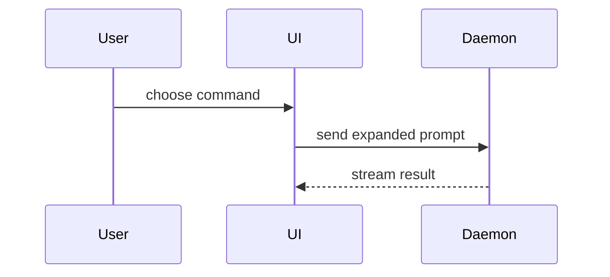

Write a PR body the reviewer takes in at a glance: pictures first, few words. Use this template:

```markdown
**Solves:** <one line, in the issue's terms> · <issue link> · <origin, sibling PR>

## Summary

<visual: screenshot, video, chart, diagram, diff-sketch or tree>

## You need to

- [ ] <manual check or decision; why it is not automated; whether a verification journey could cover
      it>

## Evidence

**Verdict:** <PASS, PASS+NOTES or FAIL, from an agent that did not write the code>

- **Before:** <screenshot/video/chart/output/failing test run> **After:**
  <screenshot/video/chart/output/passing test run>

## Merge Danger

**Door:** <one-way or two-way>

<optional: description>

**Blast Radius:** <one-word description>

<optional: potential ramifications of merge>

**Risk call:** <safe to merge without human review, or not, and why>
```

Leave out **You need to** when nothing is left for the human.

## Sections

Skip all preambles and keep prose brief. Use the repository's domain language (`CONTEXT.md` or its
glossary). Leave out SHAs, revision numbers and process notes (review history, who verified what,
earlier verdicts); link details instead of pasting them.

## Media

Prefer media over prose wherever it shows the point faster, here and in issues:

| Change                        | Best evidence                                          |
| ----------------------------- | ------------------------------------------------------ |
| Interaction or flow in the UI | GIF up to 10 s, before and after; longer: MP4          |
| Visual change                 | Screenshots, before and after, the change boxed        |
| Numbers (counts, timings)     | A chart rendered to PNG, with the query that made it   |
| Structure or control flow     | Diagram: Mermaid where the host renders it, else a PNG |
| Behaviour                     | The failing and passing test run                       |

Capture media from the running system (the repo's verification skill or Aspire). For Azure DevOps,
upload with `tengella devops pr attach --repository <repo> --id <pr> --file-path <path> --json`. Use
a released CLI carrying that command. It accepts PNG, JPG, GIF and MP4 up to 10 MiB and verifies the
upload by read-back. Uploading does not embed: insert the returned Markdown through
`tengella devops pr update <pr> --description-file <file>` or
`tengella devops pr thread create <pr> --content-file <file>`. For other hosts, use their attachment
mechanism. Keep media out of the repository.

[`scripts/media.sh`](scripts/media.sh) prepares media: `check` first on a new machine (it prints the
fix for each missing tool), then `crop`, `annotate`, `mermaid` and `gif`.

- **Screenshots:** capture at 2× device scale and crop to the part that changed. Box the change on
  the After image with `media.sh annotate`; leave Before clean.
- **Layout:** stack Before above After under bold labels. Hosts render the body about 770 px wide,
  so a two-column table halves each image; use one only for narrow crops.
- **Full size:** on Azure DevOps, clicking an inline image does nothing. Wrap each one in a link to
  itself: `[](URL)`. This doubles a ~190-character URL against the
  4000-character limit, so pick the few images that carry the point.
- **Diagrams:** where Mermaid does not render, write the `.mmd`, render it with `media.sh mermaid`
  and attach the PNG.
- **Recordings:** a GIF plays without a click, so it suits short loops; `media.sh gif` converts a
  recording. Attach longer recordings as MP4.

What renders in a PR body (Azure DevOps tested on a live PR, November 2026; GitHub not tested here):

| Markup                        | Azure DevOps                    | GitHub          |
| ----------------------------- | ------------------------------- | --------------- |
| ` ```mermaid ` block          | Code block, not a diagram       | Diagram         |
| `::: mermaid` (wiki syntax)   | Plain text                      | Plain text      |
| ``             | Inline, scaled to fit; no click | Opens full size |
| `[](url)`          | Opens the original in the tab   | Opens full size |
| ``           | 300 px wide                     | Untested        |
| `` | 300 px wide                     | 300 px wide     |
| ``            | Video player                    | Untested        |
| Uploaded MP4 (drag and drop)  | Not applicable                  | Video player    |
| `<video src controls>`        | Video player                    | Untested        |
| GIF                           | Inline, plays                   | Inline, plays   |
| `<details><summary>`          | Collapsible                     | Collapsible     |

Save a copy of every screenshot and recording in `~/.t3/userdata/sprint-evidence/<repo>-<branch>/`.
Sprint delivery takes its pictures from there.

### Summary

Pick the smallest view that makes the key point clear.

- Show logic or an algorithm as pseudocode:

```text
on(save)
  if content is unchanged
    return cached result
  write new content
  return fresh result
```

- Show runtime control flow as a call tree:

```text
submitForm
  createSession
    persistPrompt
    launchAgent
  navigateToSession
```

- Show UI structure as a component tree, including state and module boundaries that matter:

```text
<SessionPage> (apps/example/src/routes/session.tsx)
  useSessionEvents()
  <SessionToolbar>
    <RunSkillButton> (packages/ui)
```

- Show file responsibility or a broad refactor as a shallow file tree:

```text
src/
├── commands/       # parses user actions
├── sessions/       # owns session state
└── transport/      # sends API requests
```

- Show component interaction, control flow, or data flow with Mermaid (on Azure DevOps, as a
  rendered PNG; see Media):



- Use `diff` when the point is what changes and the surrounding shape already exists. Match the diff
  shape to the topic.

For a component change:

```diff
 <SessionPage>
   useSessionEvents()
   <SessionToolbar>
+    <RunSkillButton />
   <SessionTimeline>
+    <SkillResultCard />
```

For a file-layout change:

```diff
 src/
 ├── commands/
+│   └── show-me.ts       # expands the slash command
 ├── sessions/
-└── transport.ts
+└── transport/
+    ├── client.ts
+    └── stream.ts
```

For a call-tree or call-stack change:

```diff
 submitForm
   createSession
     persistPrompt
+    expandSkillMention
     launchAgent
-  navigateToSession
+  navigateToSession
+    subscribeToEvents
```

For a state or control-flow change:

```diff
 on(save)
-  write content
+  if content is unchanged
+    return cached result
+  write new content
+  invalidate cache
```

- Show the whole block when most of it is new, when omitted context would hide ownership or order,
  or when the user needs a copyable target shape:

```ts
function expandSkill(command: string): string {
  const skillName = command.slice(1);
  return `use the ${skillName} skill`;
}
```

#### Guidance

Place each visual next to the short text it supports. Keep only the calls, files, props, states, and
boundaries needed to answer the user's current question or the options to resolve the current
discussion point.

You may use one of these, you may use several, it is unlikely you will use all of them. Use your
judgement and don't overwhelm the user.

### Evidence

Concrete evidence that the change works: **show, don't tell**. Each item is a picture or a pasted
artifact of the run, with a before and an after.

Screenshots are S-tier - when the environment is set up for it and the change is visual. A visible
change without a screenshot is unfinished evidence.

Execution-based evidence is A-tier: the exact test that now fails and passes, or the console output,
in a fenced block trimmed to the lines that prove the point:

```text
Before  OrderNarrativeTests.Draft_can_edit_purpose   FAIL  403 NarrativeLocked
After   OrderNarrativeTests.Draft_can_edit_purpose   PASS
```

A claim about a run is telling, not showing: "31 checks pass", "verified locally", "review passed".
Replace it with the run itself, or leave it to CI's own status.

### Merge Danger

Describe whether it's a one-way or two-way door. You can walk back through two-way doors, but not
one-way doors. A PR that is cheap to roll back is lower risk. Changes that involve destructive
actions or hard-to-reverse decisions are one-way doors.

The blast radius is the potential impact or scope of the changes introduced by this PR. Consider all
possibilities. Examples are layout shift, breakages for consumers, mobile responsiveness, etc.

## PR Guide

In T3 Code, once the PR is published, call `write_pull_request_guides` with every PR in the change
(sibling PRs together, up to 20). It writes the reviewer's guided tour into T3's PR Guide tab. A
guide is tied to its head commit, so call it again after each push that changes the head. Runs take
minutes; continue meanwhile, and before handing back read each with `read_pull_request_guide` and
report whether its guide is ready. Outside T3 Code, skip this section.

## Check

Before publishing, run `python3 scripts/check_body.py <body.md> [--host azure|github] [--draft]`
from this skill's folder. It fails on a missing section, an unfilled placeholder or a body over the
host's limit (Azure DevOps: 4000 characters), and on an empty verdict unless `--draft`. It warns on
local paths, full SHAs, claims about a run and, on Azure DevOps, images not linked to their
original; a Mermaid block is an error there. Fix every error; fix a warning unless it is wrong.
