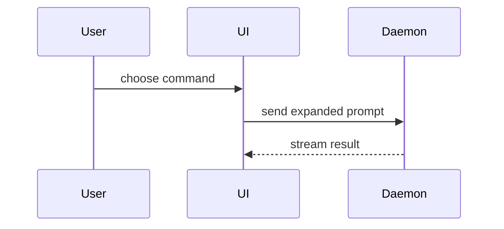

Write a PR body the reviewer takes in at a glance: pictures first, few words. Use this template:

```markdown
**Solves:** <one line, in the issue's terms> · <issue link> · <origin, sibling PR>

## Summary

<visual: screenshot, video, chart, diagram, diff-sketch or tree>

## You need to

- [ ] <manual check or decision; why it is not automated; whether a verification journey could cover
      it>

## Evidence

**Verdict:** <PASS, PASS+NOTES or FAIL, from an agent that did not write the code>

- **Before:** <screenshot/video/chart/output/failing test run> **After:**
  <screenshot/video/chart/output/passing test run>

## Merge Danger

**Door:** <one-way or two-way>

<optional: description>

**Blast Radius:** <one-word description>

<optional: potential ramifications of merge>

**Risk call:** <safe to merge without human review, or not, and why>
```

Leave out **You need to** when nothing is left for the human.

## Sections

Skip all preambles and keep prose brief. Use the repository's domain language (`CONTEXT.md` or its
glossary). Leave out SHAs, revision numbers and process notes; link details instead of pasting them.

## Media

Prefer media over prose wherever it shows the point faster, here and in issues:

| Change                        | Best evidence                                          |
| ----------------------------- | ------------------------------------------------------ |
| Interaction or flow in the UI | Short video or GIF, before and after                   |
| Visual change                 | Screenshots, before and after                          |
| Numbers (counts, timings)     | A chart rendered to PNG, with the query that made it   |
| Structure or control flow     | Diagram: Mermaid where the host renders it, else ASCII |
| Behaviour                     | The failing and passing test run                       |

Capture media from the running system (the repo's verification skill or Aspire). Upload it as an
attachment to the PR or issue. When the tooling cannot upload, say so in the hand-back; never commit
media to the repository just to show it.

### Summary

Pick the smallest view that makes the key point clear.

- Show logic or an algorithm as pseudocode:

```text
on(save)
  if content is unchanged
    return cached result
  write new content
  return fresh result
```

- Show runtime control flow as a call tree:

```text
submitForm
  createSession
    persistPrompt
    launchAgent
  navigateToSession
```

- Show UI structure as a component tree, including state and module boundaries that matter:

```text
<SessionPage> (apps/example/src/routes/session.tsx)
  useSessionEvents()
  <SessionToolbar>
    <RunSkillButton> (packages/ui)
```

- Show file responsibility or a broad refactor as a shallow file tree:

```text
src/
├── commands/       # parses user actions
├── sessions/       # owns session state
└── transport/      # sends API requests
```

- Show component interaction, control flow, or data flow with Mermaid:



- Use `diff` when the point is what changes and the surrounding shape already exists. Match the diff
  shape to the topic.

For a component change:

```diff
 <SessionPage>
   useSessionEvents()
   <SessionToolbar>
+    <RunSkillButton />
   <SessionTimeline>
+    <SkillResultCard />
```

For a file-layout change:

```diff
 src/
 ├── commands/
+│   └── show-me.ts       # expands the slash command
 ├── sessions/
-└── transport.ts
+└── transport/
+    ├── client.ts
+    └── stream.ts
```

For a call-tree or call-stack change:

```diff
 submitForm
   createSession
     persistPrompt
+    expandSkillMention
     launchAgent
-  navigateToSession
+  navigateToSession
+    subscribeToEvents
```

For a state or control-flow change:

```diff
 on(save)
-  write content
+  if content is unchanged
+    return cached result
+  write new content
+  invalidate cache
```

- Show the whole block when most of it is new, when omitted context would hide ownership or order,
  or when the user needs a copyable target shape:

```ts
function expandSkill(command: string): string {
  const skillName = command.slice(1);
  return `use the ${skillName} skill`;
}
```

#### Guidance

Place each visual next to the short text it supports. Keep only the calls, files, props, states, and
boundaries needed to answer the user's current question or the options to resolve the current
discussion point.

You may use one of these, you may use several, it is unlikely you will use all of them. Use your
judgement and don't overwhelm the user.

### Evidence

Concrete evidence that the change works. Show a before and after.

Screenshots are S-tier - when the environment is set up for it and the change is visual.

Execution-based evidence is A-tier. Test results, console output. Show the exact test that now fails
and passes, using pseudocode.

### Merge Danger

Describe whether it's a one-way or two-way door. You can walk back through two-way doors, but not
one-way doors. A PR that is cheap to roll back is lower risk. Changes that involve destructive
actions or hard-to-reverse decisions are one-way doors.

The blast radius is the potential impact or scope of the changes introduced by this PR. Consider all
possibilities. Examples are layout shift, breakages for consumers, mobile responsiveness, etc.
